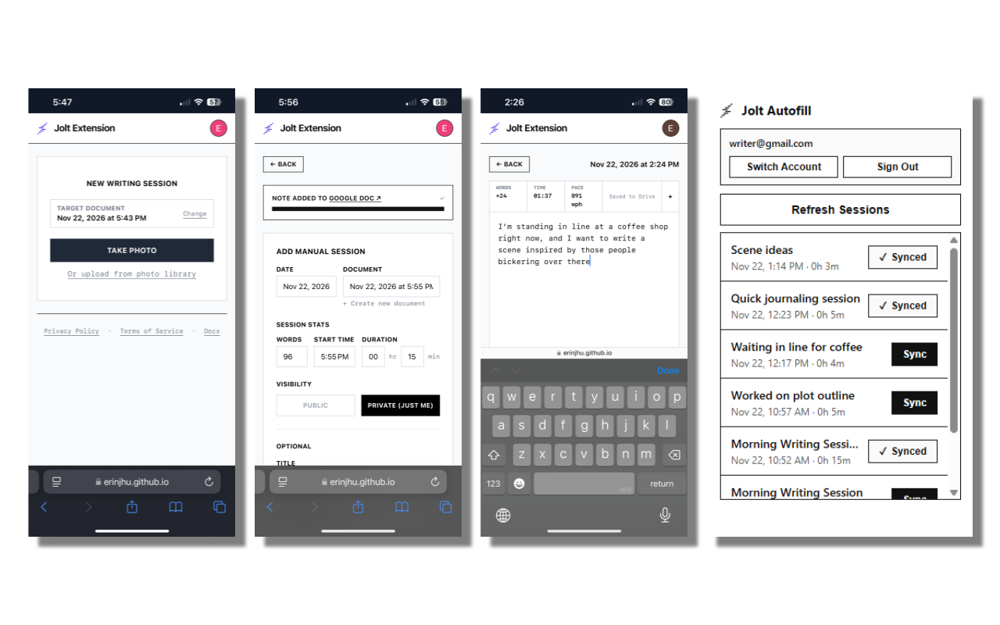

# Jolt for Phone

1. [Web app](https://erinjhu.github.io/jolt-extension/): Use your phone to scan handwritten pages or type. It then syncs the session to Google Docs.
2. [Chrome extension](https://chromewebstore.google.com/detail/bjpfalhlenokkgibijegojillljinojf?utm_source=item-share-cb): When you get back to your laptop, import your phone session into Jolt.

## How It Works

1. After you scan a handwritten page or write in the editor, the web app saves the text to a Google Doc. 
2. Then, it adds the session to
   `JoltSync/jolt_sessions.json` in your Google Drive.
3. When you open the extension in the Chrome, press Sync. The extension will automatically open and fill in Jolt's **Add Manual Session** form.
4. The extension leaves the form open for you to review and submit.

## Tech Stack

| Area | Technologies |
| --- | --- |
| Web app | React 18, TypeScript, Vite, Tailwind CSS |
| Chrome extension | TypeScript, Vite, Manifest V3 |
| OCR | Google Drive OCR, Tesseract.js |
| Google APIs | Drive, Docs, Picker |
| Authentication | Google Identity Services (web app), `chrome.identity` (extension) |
| Storage | Google Drive and Google Docs; no backend or database |
| Hosting | GitHub Pages, deployed with GitHub Actions |

See [local_development.md](local_development.md) for setup instructions.

## Documentation

The [`docs/`](docs/README.md) folder explains the web app in more detail:

- [Docs index & architecture overview](docs/README.md)
- [Auth, Guest Mode & screen state machine](docs/auth-and-routing.md)
- [Scan Mode & append-only editor flows](docs/scan-and-editor-flows.md)
- [Codebase module map](docs/module-map.md)
- [Design system & engineering rules](docs/design-conventions.md)